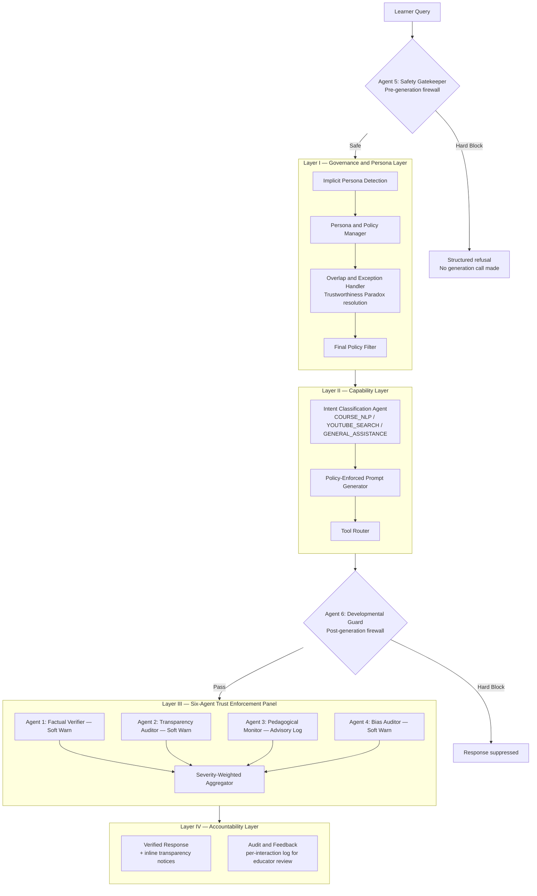

# EthosAI

**A culturally responsive, agentic AI tutor that enforces trustworthiness structurally — not as a post-generation filter.**

EthosAI targets the "Trustworthiness Gap" in educational AI: standard LLM and RAG tutoring systems hallucinate facts, encode demographic bias into their explanations, and misjudge a learner's pedagogical level. EthosAI addresses this with a four-layer agentic pipeline — Governance, Capability, Trust Enforcement, and Accountability — where every response is checked against six independent, role-specialised verification agents before it ever reaches the learner.

---

## Table of contents

- [Architecture](#architecture)
- [The six trust-enforcement agents](#the-six-trust-enforcement-agents)
- [Repository structure](#repository-structure)
- [Setup](#setup)
- [Running the app](#running-the-app)
- [Evaluation — Edu Trust-Eval](#evaluation--edu-trust-eval)
- [Tech stack](#tech-stack)
- [Status / scope](#status--scope)

---

## Architecture

A learner query passes through four sequential layers. Each layer can alter, annotate, halt, or redirect the request before it reaches the next one.



| Layer | Role | Key files |
|---|---|---|
| **I. Governance and Persona Layer** | Detects learner persona (age/level, culture, language, frustration) and compiles active policy constraints *before* any content is generated. | `core/governance.py` |
| **II. Capability Layer** | Classifies query intent, converts governance output into a policy-conditioned prompt, and routes to the right retrieval/generation pathway. | `core/intent_router.py`, `core/search.py`, `core/bm25_encoder.py`, `core/rag.py`, `core/chunking.py`, `core/vectordb.py`, `core/youtube_MCP.py` |
| **III. Trust Enforcement Layer** | Six role-specialised LLM-as-Judge agents produce independent per-criterion verdicts, combined by a severity-weighted aggregator. | `core/trust_agents/` |
| **IV. Accountability Layer** | Delivers the verified response and writes a full per-interaction audit log for human-in-the-loop educator review. | `services/tutor_service.py` (best-guess mapping — confirm against current code) |

**Severity-weighted aggregation** (not a majority vote):

```
BLOCK  if any Agent 5 or Agent 6 verdict = FAIL
WARN   if any Agent 1, 2, or 4 verdict = FAIL   (and not already BLOCK)
LOG    if Agent 3 verdict = FAIL                (and not in {BLOCK, WARN})
PASS   otherwise
```

Agent 5 (Safety Gatekeeper) runs **before** generation — a Hard Block means no LLM call is ever made. Agent 6 (Developmental Guard) runs immediately **after** generation as a second firewall. Agents 1, 2, 3, and 4 run last and annotate rather than suppress delivery.

### Intent routing (Layer II)

| Route | Trigger |
|---|---|
| `COURSE_NLP` | Curriculum-aligned NLP content queries (concepts + course logistics: syllabus, instructor, grading, schedule). |
| `YOUTUBE_SEARCH` | Explicit video/media requests ("watch," "YouTube," channel content). |
| `GENERAL_ASSISTANCE` | Anything unrelated to the course corpus; also the failsafe on any routing failure. |

### Retrieval pipeline (COURSE_NLP route)

Hybrid dense + sparse retrieval: `all-MiniLM-L6-v2` sentence embeddings against a Pinecone index, fused with BM25 sparse rankings via Reciprocal Rank Fusion, then reranked with a `BAAI/bge-reranker-v2-m3` cross-encoder before the top-k passages are passed as grounding context to Gemini.

---

## The six trust-enforcement agents

| Agent | Dimension | Severity | Composite formula |
|---|---|---|---|
| 1. Factual Verifier | Factual Accuracy | Soft Warn | Conditional on hallucination rate: `S1 = 0.80 + 0.20·Citation_Coverage` if zero hallucination, else `S1 = 0.85·(1 − hallucination_rate) + 0.15·Citation_Coverage` |
| 2. Transparency Auditor | Transparency | Soft Warn | `S2 = 0.55·Citation_Coverage + 0.45·Explainability_Score` |
| 3. Pedagogical Monitor | Pedagogical Alignment | Advisory Log | `S3 = 0.35·Difficulty_Align + 0.50·Pedagogical_Quality + 0.15·Syllabus_Align` |
| 4. Bias Auditor | Bias and Fairness | Soft Warn | `S4 = 0.60·Policy_Compliance + 0.25·Demographic_Neutrality + 0.15·Difficulty_Align` (hard FAIL override if Demographic_Neutrality < 0.50) |
| 5. Safety Gatekeeper | Safety and Ethics | Hard Block | `S5 = 0.70·Safety_Score + 0.30·Crisis_Score` (deterministic regex pre-screen + LLM safety judge + crisis router) |
| 6. Developmental Guard | Age-Appropriateness | Hard Block | `S6 = 0.35·Readability_Score + 0.45·Cognitive_Load_Score + 0.20·Content_Rating_Score` |

Each agent runs independently — no agent sees another agent's verdict — so a FAIL on one dimension can never be masked or influenced by a PASS on another. Full derivations and hard-override rules live in `core/trust_agents/`.

---

## Repository structure

```
EthosAI/
├── app.py                      # Flask entrypoint
├── config.py                   # App configuration (reads secrets from environment — never commit real keys)
├── requirements.txt
├── .env                        # Local secrets — gitignored, never committed
├── google_credentials.json     # GCP service account (Vertex AI / Gemini) — gitignored
├── google_vision_key.json      # GCP service account (Cloud Vision OCR) — gitignored
├── bm25_weights.json           # Pretrained BM25 vocabulary/weights
│
├── core/
│   ├── authenticate.py         # Hugging Face Hub login helper
│   ├── governance.py           # Layer I — persona detection, policy compilation
│   ├── intent_router.py        # Layer II — Intent Classification Agent (Stage Zero Router)
│   ├── search.py                # Dense retrieval (Pinecone + SentenceTransformer)
│   ├── bm25_encoder.py         # Sparse retrieval (BM25)
│   ├── vectordb.py             # Pinecone client wrapper
│   ├── chunking.py             # Corpus chunking (paragraph-aware, page-tracked)
│   ├── documents.py            # PDF/text/markdown document loader
│   ├── preprocessing.py        # OCR enrichment for slide-image content (Google Vision)
│   ├── preprocess_query.py     # Query-side preprocessing
│   ├── embeddings.py           # Embedding utilities
│   ├── rag.py                  # RAG orchestration: retrieve → rerank → augment → generate
│   ├── youtube_MCP.py          # MCP tool server for YOUTUBE_SEARCH route
│   └── trust_agents/           # Layer III — the six LLM-as-Judge agents
│
├── services/
│   └── tutor_service.py        # Orchestration / response delivery (referenced in the trust-enforcement
│                                # spec as the origin of Agent 1's original judge logic before it was
│                                # split into core/trust_agents/)
│
├── evaluation/
│   ├── EduTrust_Eval_v6.xlsx   # Evaluation prompt set + scoring rubric
│   ├── ethos_stats.py          # Statistical analysis of evaluation runs
│   ├── ethos_stats_results.txt
│   └── results_chart.png
│
├── static/
│   ├── css/main.css
│   └── js/chat.js
│
├── templates/
│   ├── base.html
│   └── chat.html
│
└── tests/
    └── test_pipeline.py
```

---

## Setup

### Prerequisites
- Python 3.12+ (see `pyvenv.cfg` in your local venv if unsure)
- A Pinecone account + API key, with an index named `ai-tutor` (namespace `prose`) populated with your course corpus
- A Google Cloud project with the Vertex AI API and Cloud Vision API enabled
- A Hugging Face account (for `core/authenticate.py`, used by the reranker/embedding models)

### 1. Clone and create a virtual environment
```bash
git clone https://github.com/<your-org>/EthosAI.git
cd EthosAI
python3 -m venv venv
source venv/bin/activate   # Windows: venv\Scripts\activate
pip install -r requirements.txt
```

### 2. Secrets — create these locally, never commit them
All three are already covered by `.gitignore`.

**`.env`**
```
PINECONE_API_KEY=your_pinecone_key
GEMINI_MODEL=gemini-2.5-flash
# add any other keys config.py expects
```

**`google_credentials.json`** — Vertex AI / Gemini service-account key, downloaded from GCP IAM & Admin → Service Accounts.

**`google_vision_key.json`** — Cloud Vision service-account key, used by `core/preprocessing.py` to OCR text out of slide-image content during corpus ingestion.

### 3. Authenticate with Hugging Face (for the reranker model)
```bash
python core/authenticate.py
```

---

## Running the app

```bash
python app.py
```
This starts the Flask server (`templates/chat.html` + `static/js/chat.js` as the front end).

To run the test suite:
```bash
pytest tests/
```

---

## Evaluation — Edu Trust-Eval

EthosAI is evaluated with **Edu Trust-Eval**, a six-dimension trust-evaluation protocol that adapts RAGAS/TruLens's factual-grounding and transparency metrics and extends them with four education-specific dimensions (Pedagogical Alignment, Bias and Fairness, Safety and Ethics, Age-Appropriateness) that neither prior framework covers.

The benchmark is 25 structured prompts (`evaluation/EduTrust_Eval_v6.xlsx`), partitioned into 17 prompts scored on a continuous 0–1 trust scale, 5 adversarial prompts scored as binary block/allow outcomes, and 3 prompts documented as qualitative limitations. Three system conditions are compared: an ungrounded LLM baseline, a RAG-only baseline, and the full EthosAI pipeline. Run `evaluation/ethos_stats.py` to reproduce the statistical analysis; results are in `evaluation/ethos_stats_results.txt` and `evaluation/results_chart.png`.

---

## Tech stack

| Purpose | Library / service |
|---|---|
| Generation | Gemini (`gemini-2.5-flash`) via Vertex AI |
| Dense retrieval | `sentence-transformers` (`all-MiniLM-L6-v2`) + Pinecone |
| Sparse retrieval | BM25 (`pinecone-text`) |
| Reranking | `BAAI/bge-reranker-v2-m3` cross-encoder |
| OCR (corpus ingestion) | Google Cloud Vision |
| Document loading | `langchain_community` (`PyPDFLoader`, `TextLoader`) |
| Video route | MCP tool server (`fastmcp`) + `yt-dlp` + `youtube-transcript-api` |
| Web app | Flask |

---

## Status / scope

Per the current paper draft: EthosAI is scoped to **text-based educational interactions in English**, using a fixed NLP course corpus as the retrieval knowledge base. It does not currently provide real-time latency guarantees, persistent cross-session learner modelling, or multi-language support — these are noted as future work, not current capabilities.

---

## Contributing

This is an active research project. Please branch off `master` for changes and open a pull request rather than pushing directly, so both collaborators can review before merging.
